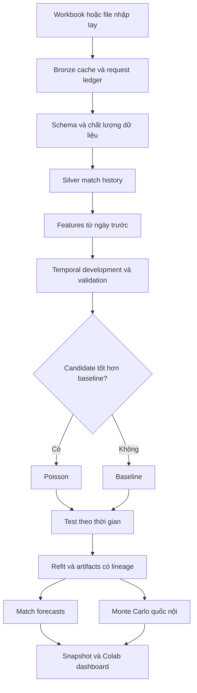

# Kiến trúc PitchOps

Mục tiêu bản đầu là hoàn thành một vòng dữ liệu → huấn luyện → đánh giá → dự đoán → dashboard ngay trên Colab, với khả năng chạy lại và kiểm tra nguồn gốc. Chưa cần Kubernetes, Kafka hoặc một GPU lớn cho mô hình bảng đầu tiên.

## Những lựa chọn có chủ đích

| Vấn đề | Lựa chọn hiện tại | Khi nào nâng cấp |
|---|---|---|
| Hàng loạt trang web khác schema | Provider adapter + data contract | Thêm canonical ID và raw provenance trước khi nối nguồn |
| Mô hình phức tạp chưa chắc tốt | Poisson + baseline + chronological gate | Sau backtest nhiều mùa, thử Dixon–Coles, hierarchical Bayes, gradient boosting |
| Xác suất thiếu calibration | Báo log loss/Brier/reliability | Fit calibrator trên tập riêng, kiểm tra trên test phía sau |
| Góc/cú sút overdispersion | Poisson thử nghiệm có MAE | So sánh Negative Binomial và empirical coverage |
| Lịch thi đấu tương lai | Suy ra cặp còn lại ở giải vòng tròn | Kết nối fixture API có ngày, hoãn trận và thể thức |
| Dữ liệu toàn cầu | Hiển thị coverage và từ chối khi không đủ | Thêm provider được cấp phép theo league/season/feature |
| Colab bị ngắt | Artifact theo run + Drive tùy chọn | Compute có scheduler nếu được chấp nhận sau này |
| Dashboard đẹp nhưng có thể gây hiểu nhầm | Nhãn research, thời điểm dữ liệu, giới hạn cạnh dự đoán | Thêm audit và version selector khi có nhiều snapshot |

## Lộ trình theo thứ tự phụ thuộc

1. **Dữ liệu và đánh giá:** thêm nhiều mùa qua file nhập tay hợp lệ hoặc provider có quota phù hợp; backtest cuốn chiếu theo từng giải, bootstrap CI theo ngày, dữ liệu đã lưu đúng publication-time, negative-binomial và Dixon–Coles; fit calibration riêng.
2. **Cầu thủ:** canonical IDs, transfers, injury/suspension, expected lineup/appearance/minutes; scorer goal-share model điều kiện theo team total; position-specific rating model; đánh giá MAE/NLL và calibration theo vị trí. Cần tránh double counting số bàn đội/cầu thủ.
3. **Giải thưởng và heatmap:** thống nhất định nghĩa “đội hình xuất sắc”, nhãn rating/MOTM; forecast phân phối đóng góp tương lai và rank theo vị trí; spatial density model chỉ khi có tọa độ và nhãn train phù hợp. Không suy tracking từ vài điểm sự kiện.
4. **Quốc tế:** engine cấu hình league phase/group/knockout, quy tắc bốc thăm, hai lượt, extra time và penalties. Club và national-team ratings cần tách domain; chọn bất kỳ hai đội ngoài domain không được coi như trận cùng giải.
5. **Vận hành production:** scheduler ổn định, provider API key trong secret manager, kho object immutable, registry champion/challenger qua nhiều run, promotion/rollback, prediction log + delayed outcome join + drift alerts, API authentication và dashboard hosting riêng.

Chưa tự động chạy theo tuần trong khi Colab đóng. Không tự tạo GitHub Actions training vì yêu cầu hiện tại là chạy trên Colab. Có thể commit/push code từ notebook bằng token người dùng tự cấp trong Colab Secrets, hoặc dùng GitHub UI; không cần chia sẻ token qua chat.
